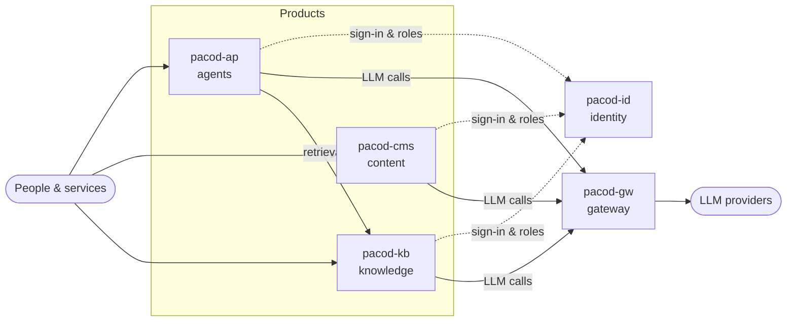

<div align="center">

# pacod

**Open-source building blocks for AI products that you run yourself.**

One gateway for every model · one sign-in for every product · platforms for agents, content and knowledge.

[](https://ai.pacod.io)
[](https://www.apache.org/licenses/LICENSE-2.0)


[**Website**](https://ai.pacod.io) · [Projects](https://ai.pacod.io/projects) · [Architecture](https://ai.pacod.io/#architecture)

[English](https://ai.pacod.io/) · [Български](https://ai.pacod.io/bg) · [Deutsch](https://ai.pacod.io/de) · [Русский](https://ai.pacod.io/ru)

</div>

---

## Projects

Each project is a complete product with its own repository, documentation and Docker setup. Use one on its own or run them together.

| | Project | Role | Highlights | Stack |
|---|---|---|---|---|
| **GW** | [pacod-gw](https://github.com/pacod22/pacod-gw) · [docs](https://ai.pacod.io/projects/pacod-gw) | AI gateway | Proxy + managed modes on one core · OpenAI / Anthropic / Gemini dialects · quotas, cost, analytics per workspace | Rust · PostgreSQL · ClickHouse · SvelteKit |
| **ID** | [pacod-id](https://github.com/pacod22/pacod-id) · [docs](https://ai.pacod.io/projects/pacod-id) | Identity & access | OpenID Connect (conformance-tested) · one rules engine in Rust, TS, Python · branded sign-in, light/dark | Rust · axum · PostgreSQL · OIDC |
| **AP** | [pacod-ap](https://github.com/pacod22/pacod-ap) · [docs](https://ai.pacod.io/projects/pacod-ap) | Agent-building platform | Many isolated agents, one deployment · RAG, MCP tools, visual agent editor · review loop that improves every agent | FastAPI · LangGraph · MCP · SvelteKit |
| **KB** | [pacod-kb](https://github.com/pacod22/pacod-kb) · [docs](https://ai.pacod.io/projects/pacod-kb) | RAG knowledge base | Hybrid search (BGE-M3 + BM25) · versioned, point-in-time queries · built-in prompt-injection defence | FastAPI · Qdrant · BGE-M3 · BM25 |
| **CM** | [pacod-cms](https://github.com/pacod22/pacod-cms) · [docs](https://ai.pacod.io/projects/pacod-cms) | Content management | Many websites on one stack · articles, ads, statistics in one studio · AI translation via the gateway | Java 25 · Spring Boot 4.1 · Thymeleaf · MongoDB |

## How they fit together

Every LLM call goes through **pacod-gw**. Every person and service signs in through **pacod-id**. Products on top stay simple and never hold a provider key.



Interactive version: [ai.pacod.io/#architecture](https://ai.pacod.io/#architecture)

## Principles

| Principle | Meaning |
|---|---|
| **Open source** | Apache-2.0 — source, tests and threat models in the open |
| **Self-hosted** | Docker Compose for a laptop, Helm charts where it matters; data stays on your machines |
| **One sign-in** | pacod-id authenticates users across all products and records what they may do |
| **One gateway** | pacod-gw holds keys, prices calls and enforces quotas for every product |

## Quick start

Every project starts with a couple of `make` commands and a **mock model provider** — nothing leaves your machine until you configure a real one.

```bash
git clone https://github.com/pacod22/pacod-gw.git
cd pacod-gw
# follow the README of the repository
```

Recommended order: **pacod-gw → pacod-id → pacod-ap / pacod-kb / pacod-cms**.
Start here: [ai.pacod.io/projects/pacod-gw](https://ai.pacod.io/projects/pacod-gw)

## Contributing

Issues and ideas are welcome in each project's issue tracker.
Code contributions are **not accepted** at this time.

## License

All projects are licensed under the [Apache License 2.0](https://www.apache.org/licenses/LICENSE-2.0).

<div align="center">
<sub><a href="https://ai.pacod.io">ai.pacod.io</a> · <a href="https://github.com/pacod22">github.com/pacod22</a></sub>
</div>


<!--
**pacod22/pacod22** is a ✨ _special_ ✨ repository because its `README.md` (this file) appears on your GitHub profile.

Here are some ideas to get you started:

- 🔭 I’m currently working on ...
- 🌱 I’m currently learning ...
- 👯 I’m looking to collaborate on ...
- 🤔 I’m looking for help with ...
- 💬 Ask me about ...
- 📫 How to reach me: ...
- 😄 Pronouns: ...
- ⚡ Fun fact: ...
-->
