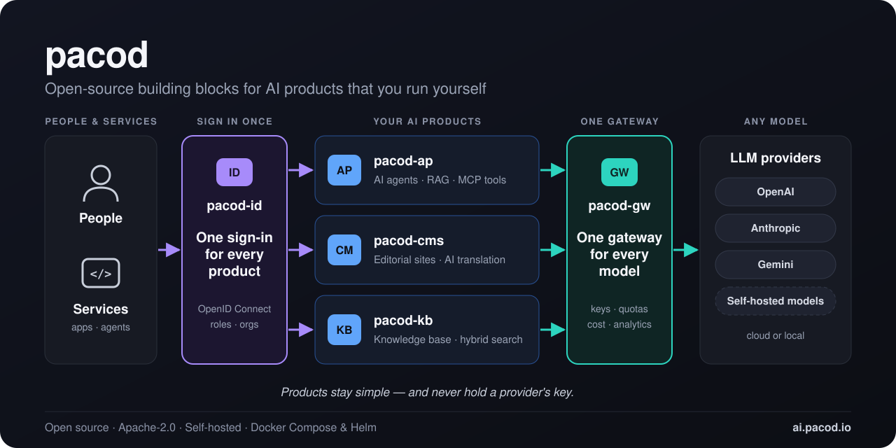
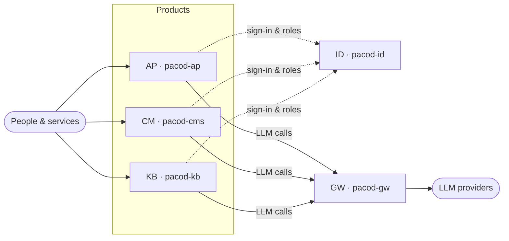

<div align="center">

<a href="https://ai.pacod.io"></a>

# pacod

**Building blocks for AI products that you run yourself.**

Five open-source projects that fit together: one gateway for every model, one sign-in for every product,<br>
and the platforms you build on top of them — agents, content and knowledge.

[](https://ai.pacod.io)
[](https://www.apache.org/licenses/LICENSE-2.0)


[**Website**](https://ai.pacod.io) · [Projects](https://ai.pacod.io/projects) · [How it fits](https://ai.pacod.io/#architecture)

[English](https://ai.pacod.io/) · [Български](https://ai.pacod.io/bg) · [Deutsch](https://ai.pacod.io/de) · [Русский](https://ai.pacod.io/ru)

</div>

---

## Projects

Use one on its own, or run them together. Each is a complete product with its own repository, documentation and Docker setup.

| | Project | Role | What it does | Repo |
|---|---|---|---|---|
| **GW** | [pacod-gw](https://ai.pacod.io/projects/pacod-gw) | AI gateway | One gateway in front of every model — keys, prices, quotas and usage your apps should not hold | [](https://github.com/pacod22/pacod-gw) |
| **CM** | [pacod-cms](https://ai.pacod.io/projects/pacod-cms) | Content management | One stack, many editorial websites — articles, ads, statistics, built-in AI translation | [](https://github.com/pacod22/pacod-cms) |
| **AP** | [pacod-ap](https://ai.pacod.io/projects/pacod-ap) | Agent-building platform | Any number of AI agents on one deployment — each with own knowledge, prompts, rules | [](https://github.com/pacod22/pacod-ap) |
| **ID** | [pacod-id](https://ai.pacod.io/projects/pacod-id) | Identity & access | One sign-in for people and machines, with recorded permissions across all products | [](https://github.com/pacod22/pacod-id) |
| **KB** | [pacod-kb](https://ai.pacod.io/projects/pacod-kb) | RAG knowledge base | Files and web pages → versioned, searchable knowledge with a stable model contract | [](https://github.com/pacod22/pacod-kb) |

<details>
<summary><b>GW · pacod-gw</b> — AI gateway</summary>

Sits between applications and LLM providers. Rust core relays or translates every call, keeps provider keys out of apps, enforces quotas, prices each request, streams usage into ClickHouse — managed from a SvelteKit console.

| Highlights | Stack |
|---|---|
| Proxy + managed modes on one Rust core<br>OpenAI, Anthropic, Gemini dialects<br>Quotas, cost, analytics per workspace | Rust · PostgreSQL · ClickHouse · SvelteKit · Caddy · Docker · Helm · Prometheus |

[Docs](https://ai.pacod.io/projects/pacod-gw) · [Repository](https://github.com/pacod22/pacod-gw)
</details>

<details>
<summary><b>CM · pacod-cms</b> — Content management</summary>

CMS for editorial websites. One installation hosts many sites, each with own database, files and cache; multilingual editor studio; fast, host-routed public sites.

| Highlights | Stack |
|---|---|
| Many websites on one stack<br>Articles, ads, statistics in one studio<br>AI translation via pacod-gw | Java 25 · Spring Boot 4.1 · Thymeleaf · MongoDB · Maven · Caddy · Gotenberg · Docker |

[Docs](https://ai.pacod.io/projects/pacod-cms) · [Repository](https://github.com/pacod22/pacod-cms)
</details>

<details>
<summary><b>AP · pacod-ap</b> — Agent-building platform</summary>

Every agent (profile) has its own knowledge base, reference facts, prompts, directives, configuration, conversations and reviews — sharing one sign-in, one admin console and one LLM gateway.

| Highlights | Stack |
|---|---|
| Many self-contained agents, one deployment<br>RAG, MCP tools, visual agent editor<br>Review loop that improves every agent | FastAPI · LangGraph · MCP · SvelteKit · PostgreSQL · Redis · Qdrant · Caddy |

[Docs](https://ai.pacod.io/projects/pacod-ap) · [Repository](https://github.com/pacod22/pacod-ap)
</details>

<details>
<summary><b>ID · pacod-id</b> — Identity and access</summary>

OpenID Connect provider for first-party applications: accounts, organisations, role bindings, and a change feed products follow to decide access locally. Client libraries for Rust, TypeScript, Python.

| Highlights | Stack |
|---|---|
| OIDC, conformance-tested<br>One rules engine in Rust, TypeScript, Python<br>Branded sign-in pages, light/dark | Rust · axum · PostgreSQL · OpenID Connect · SvelteKit · Docker · Helm |

[Docs](https://ai.pacod.io/projects/pacod-id) · [Repository](https://github.com/pacod22/pacod-id)
</details>

<details>
<summary><b>KB · pacod-kb</b> — RAG knowledge base</summary>

Ingests files and web pages, converts to canonical Markdown, indexes for hybrid semantic + keyword search, keeps every version, serves chunks with a stable metadata contract. CPU-only.

| Highlights | Stack |
|---|---|
| Hybrid search: BGE-M3 + BM25<br>Every version kept, point-in-time queries<br>Built-in prompt-injection defence | FastAPI · Qdrant · BGE-M3 · BM25 · SQLite · PostgreSQL · HTMX · Docker |

[Docs](https://ai.pacod.io/projects/pacod-kb) · [Repository](https://github.com/pacod22/pacod-kb)
</details>

## How they fit together

Every LLM call goes through the gateway. Every person signs in through the identity provider. The products on top stay simple — and never hold a provider's key.



Interactive diagram: [ai.pacod.io/#architecture](https://ai.pacod.io/#architecture)

## Built on a few firm ideas

| | |
|---|---|
| **Open source** | Apache-2.0 — source, tests and threat models in the open |
| **Self-hosted** | Docker Compose for a laptop, Helm charts where it matters; data stays on your machines |
| **One sign-in** | pacod-id signs people in to every product and records what they may do |
| **One gateway** | pacod-gw holds the keys, prices the calls and enforces the quotas — for every product |

## Try it on your laptop

Each project starts with a couple of `make` commands and a **mock model provider** — nothing leaves your machine until you want it to.

```bash
git clone https://github.com/pacod22/pacod-gw.git
cd pacod-gw
# see the repository README for the make targets
```

→ [Start with the gateway](https://ai.pacod.io/projects/pacod-gw)

## Contributing

pacod is a family of open-source projects. Issues and ideas are welcome on GitHub; **code contributions are not accepted for now**.

## License

Open source under the [Apache License 2.0](https://www.apache.org/licenses/LICENSE-2.0).

<div align="center">
<sub><a href="https://ai.pacod.io">ai.pacod.io</a> · <a href="https://github.com/pacod22">github.com/pacod22</a></sub>
</div>


<!--
**pacod22/pacod22** is a ✨ _special_ ✨ repository because its `README.md` (this file) appears on your GitHub profile.

Here are some ideas to get you started:

- 🔭 I’m currently working on ...
- 🌱 I’m currently learning ...
- 👯 I’m looking to collaborate on ...
- 🤔 I’m looking for help with ...
- 💬 Ask me about ...
- 📫 How to reach me: ...
- 😄 Pronouns: ...
- ⚡ Fun fact: ...
-->
