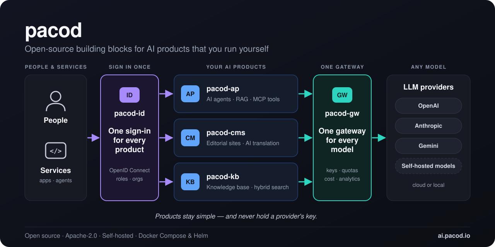
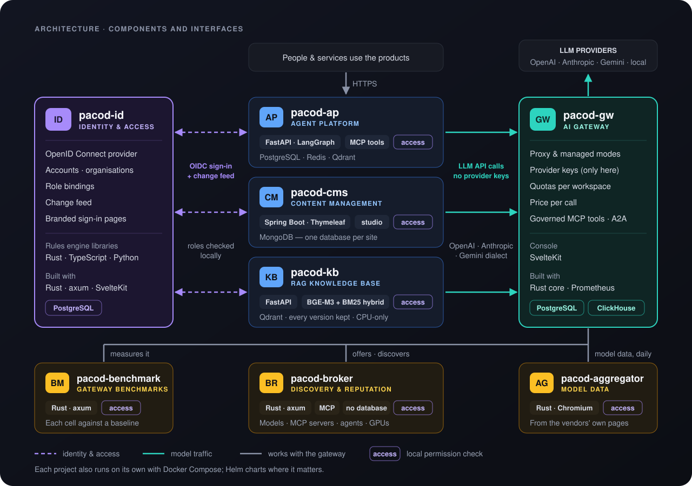

<div align="center">

<a href="https://www.pacod.io"></a>

# pacod

**Building blocks for AI products that you run yourself.**

Six open-source projects that fit together: one gateway for every model, one sign-in for every product,<br>
the platforms you build on top of them — agents, content and knowledge — and benchmarks that measure the gateway.<br>
PACOD runs its own AI assistants and its website on them, at [app.pacod.io](https://app.pacod.io) and [www.pacod.io](https://www.pacod.io).

[](https://www.pacod.io)
[](https://www.apache.org/licenses/LICENSE-2.0)


[**Website**](https://www.pacod.io) · [Assistants](https://www.pacod.io/p/assistants) · [Projects](https://www.pacod.io/p/projects) · [How it fits](https://www.pacod.io/p/architecture) · [Blog](https://www.pacod.io/latest) · [Live demo](https://demo.pacod.io) · [Run the whole stack](https://github.com/pacod22/pacod-demo)

[English](https://www.pacod.io/) · [Български](https://www.pacod.io/?lang=bg) · [Deutsch](https://www.pacod.io/?lang=de) · [Русский](https://www.pacod.io/?lang=ru)

</div>

---

## Projects

Use one on its own, or run them together. Each is a complete product with its own repository, documentation and Docker setup — and [pacod-demo](https://github.com/pacod22/pacod-demo) runs all six as one platform, live at [demo.pacod.io](https://demo.pacod.io).

| | Project | Role | What it does | Repo |
|---|---|---|---|---|
| **GW** | [pacod-gw](https://www.pacod.io/p/pacod-gw) | AI gateway | One gateway in front of every model — keys, prices, quotas and usage your apps should not hold | [](https://github.com/pacod22/pacod-gw) |
| **CM** | [pacod-cms](https://www.pacod.io/p/pacod-cms) | Content management | One stack, many editorial websites — articles, ads, statistics, built-in AI translation | [](https://github.com/pacod22/pacod-cms) |
| **AP** | [pacod-ap](https://www.pacod.io/p/pacod-ap) | Agent-building platform | Any number of AI agents on one deployment — each with own knowledge, prompts, rules | [](https://github.com/pacod22/pacod-ap) |
| **ID** | [pacod-id](https://www.pacod.io/p/pacod-id) | Identity & access | One sign-in for people and machines, with recorded permissions across all products | [](https://github.com/pacod22/pacod-id) |
| **KB** | [pacod-kb](https://www.pacod.io/p/pacod-kb) | RAG knowledge base | Files and web pages → versioned, searchable knowledge with a stable model contract | [](https://github.com/pacod22/pacod-kb) |
| **BM** | [pacod-benchmark](https://www.pacod.io/p/pacod-benchmark) | Gateway benchmarks | Measures what the gateway adds — many configurations at once, each against a baseline straight to the mock | [](https://github.com/pacod22/pacod-benchmark) |

<details>
<summary><b>GW · pacod-gw</b> — AI gateway</summary>

Sits between applications and LLM providers. Rust core relays or translates every call, keeps provider keys out of apps, enforces quotas, prices each request, streams usage into ClickHouse — managed from a SvelteKit console.

| Highlights | Stack |
|---|---|
| Proxy + managed modes on one Rust core<br>OpenAI, Anthropic, Gemini dialects<br>Quotas, cost, analytics per workspace | Rust · PostgreSQL · ClickHouse · SvelteKit · Caddy · Docker · Helm · Prometheus |

[Docs](https://www.pacod.io/p/pacod-gw) · [Repository](https://github.com/pacod22/pacod-gw)
</details>

<details>
<summary><b>CM · pacod-cms</b> — Content management</summary>

CMS for editorial websites. One installation hosts many sites, each with own database, files and cache; multilingual editor studio; fast, host-routed public sites. The PACOD website, [www.pacod.io](https://www.pacod.io), is one of them.

| Highlights | Stack |
|---|---|
| Many websites on one stack<br>Articles, ads, statistics in one studio<br>AI translation via pacod-gw | Java 25 · Spring Boot 4.1 · Thymeleaf · MongoDB · Maven · Caddy · Gotenberg · Docker |

[Docs](https://www.pacod.io/p/pacod-cms) · [Repository](https://github.com/pacod22/pacod-cms)
</details>

<details>
<summary><b>AP · pacod-ap</b> — Agent-building platform</summary>

Every agent (profile) has its own knowledge base, reference facts, prompts, directives, configuration, conversations and reviews — sharing one sign-in, one admin console and one LLM gateway. PACOD's assistants at [app.pacod.io](https://app.pacod.io) are agents on it.

| Highlights | Stack |
|---|---|
| Many self-contained agents, one deployment<br>RAG, MCP tools, visual agent editor<br>Review loop that improves every agent | FastAPI · LangGraph · MCP · SvelteKit · PostgreSQL · Redis · Qdrant · Caddy |

[Docs](https://www.pacod.io/p/pacod-ap) · [Repository](https://github.com/pacod22/pacod-ap)
</details>

<details>
<summary><b>ID · pacod-id</b> — Identity and access</summary>

OpenID Connect provider for first-party applications: accounts, organisations, role bindings, and a change feed products follow to decide access locally. Client libraries for Rust, TypeScript, Python.

| Highlights | Stack |
|---|---|
| OIDC, conformance-tested<br>One rules engine in Rust, TypeScript, Python<br>Branded sign-in pages, light/dark | Rust · axum · PostgreSQL · OpenID Connect · SvelteKit · Docker · Helm |

[Docs](https://www.pacod.io/p/pacod-id) · [Repository](https://github.com/pacod22/pacod-id)
</details>

<details>
<summary><b>KB · pacod-kb</b> — RAG knowledge base</summary>

Ingests files and web pages, converts to canonical Markdown, indexes for hybrid semantic + keyword search, keeps every version, serves chunks with a stable metadata contract. CPU-only.

| Highlights | Stack |
|---|---|
| Hybrid search: BGE-M3 + BM25<br>Every version kept, point-in-time queries<br>Built-in prompt-injection defence | FastAPI · Qdrant · BGE-M3 · BM25 · SQLite · PostgreSQL · HTMX · Docker |

[Docs](https://www.pacod.io/p/pacod-kb) · [Repository](https://github.com/pacod22/pacod-kb)
</details>

<details>
<summary><b>BM · pacod-benchmark</b> — Gateway benchmarks</summary>

Measures pacod-gw — managed and proxy modes, the minimal gateway, deployment layouts — and other gateways, in many configurations in one run. Every cell is measured against a baseline straight to the mock provider, so what is left is what the gateway adds. Its UI writes the suites, follows the runs and compares them; reports go to the gateway's console.

| Highlights | Stack |
|---|---|
| Many configurations in one run<br>Every cell against a baseline to the mock<br>Reports published to the pacod-gw console | Rust · axum · PostgreSQL · SvelteKit · Caddy · Docker · Prometheus |

[Docs](https://www.pacod.io/p/pacod-benchmark) · [Repository](https://github.com/pacod22/pacod-benchmark)
</details>

## How they fit together

Every LLM call goes through the gateway. Every person signs in through the identity provider. The products on top stay simple — and never hold a provider's key.

<p align="center">
  
</p>

| Layer | Project | Responsibility |
|---|---|---|
| Identity | pacod-id | OIDC sign-in, accounts, organisations, roles; change feed for local access checks |
| Products | pacod-ap · pacod-cms · pacod-kb | Agents, editorial sites, knowledge — sign-in via pacod-id, model calls via pacod-gw, never hold provider keys |
| Model access | pacod-gw | Provider keys, quotas, per-call pricing, usage analytics; OpenAI / Anthropic / Gemini dialects |
| Measurement | pacod-benchmark | What the gateway adds to each call, per configuration; reports published to the gateway's console |

Run together, the products share **one of each common component** on one Docker network, `pacod-net`: one Caddy, one PostgreSQL (a database and role per product), one Qdrant, one embeddings service, one pacod-id, one gateway and one monitoring stack (Prometheus, Grafana, OpenTelemetry). Stores a product owns stay with it — the gateway's ClickHouse, the CMS's MongoDB, the agent platform's Redis. Run alone, each repository brings its own copies of the shared parts.

The diagram: [www.pacod.io/p/architecture](https://www.pacod.io/p/architecture)

## In production at pacod.io

PACOD runs its own products on these projects, on one server, behind one Caddy and one pacod-id.

### AI assistants for the Bulgarian market — [app.pacod.io](https://app.pacod.io)

Three specialist assistants answer questions about Bulgarian law from the legislation in force, name the provision behind every answer, and work in Bulgarian, English, German and Russian.

| Assistant | What it covers |
|---|---|
| [Tax & Accounting](https://www.pacod.io/p/tax-assistant) | Rates, thresholds and deadlines, VAT, invoices, social and health contributions, bookkeeping |
| [Condominium & Property](https://www.pacod.io/p/condominium-assistant) | The Condominium Management Act (ЗУЕС): general meetings, quorum and majorities, the repair fund, owners' and managers' duties, property tax and waste fee |
| [Traffic Law](https://www.pacod.io/p/traffic-assistant) | The Road Traffic Act (ЗДвП): fines, penalty points and appeals, driving licences, roadworthiness tests, insurance, vignettes, vehicle tax |

How they are built on the open-source projects:

- **Agents on pacod-ap.** Each assistant is an agent on one pacod-ap deployment, with its own knowledge base, prompts, rules and reference facts. Rates, thresholds and deadlines — and, where recorded, a municipality's property-tax and waste-fee rates — are structured data the agent looks up rather than estimates. The agents also draft a monthly briefing on changes in tax and property law, curated by people.
- **Model calls through pacod-gw.** No assistant holds a provider's key. The gateway holds the keys, enforces the limits and records usage and cost per agent.
- **Sign-in through pacod-id.** One account at id.pacod.io for all three assistants, with a password or with Google.

The repositories hold the platform; the assistants' knowledge, reference data and configuration are PACOD's own. pacod-ap ships a separate `taxes` example agent, built on public Bulgarian sources, to show the approach. The assistants are an information service, not legal or tax advice.

→ [The assistants](https://www.pacod.io/p/assistants) · [How they are built](https://www.pacod.io/article/11)

### The website and blog — [www.pacod.io](https://www.pacod.io)

The PACOD website is built entirely on pacod-cms: the project pages, the assistants' pages, the blog, its banners and its four languages are served by pacod-cms and edited in its studio.

- The first content came from a folder of Markdown and pictures, built into a seed that pacod-cms checked and wrote into a new website on its *magazine* template set.
- The pages are in English, Bulgarian, German and Russian. Posts are written in English, and the studio's AI translation job — calling the model through pacod-gw — can bring them into the other three.
- Banners booked per section, Atom feeds for the website and each section, canonical and hreflang links on every page.
- The projects' earlier site, ai.pacod.io, now redirects here.

→ [Latest posts](https://www.pacod.io/latest) · [This blog runs on pacod-cms](https://www.pacod.io/article/9)

## Built on a few firm ideas

| | |
|---|---|
| **Open source** | Apache-2.0 — source, tests and threat models in the open |
| **Self-hosted** | Docker Compose for a laptop, Helm charts where it matters; data stays on your machines |
| **One sign-in** | pacod-id signs people in to every product and records what they may do |
| **One gateway** | pacod-gw holds the keys, prices the calls and enforces the quotas — for every product |

## Try it on your laptop

**The whole stack** — identity, gateway, agents, CMS, knowledge base and benchmarks working together — comes from [pacod-demo](https://github.com/pacod22/pacod-demo): one configuration file, one `make`. To see it first, it runs live at [demo.pacod.io](https://demo.pacod.io).

```bash
mkdir pacod && cd pacod
for r in pacod-demo pacod-id pacod-gw pacod-ap pacod-cms pacod-kb pacod-benchmark; do
  git clone https://github.com/pacod22/$r.git
done
cd pacod-demo
cp demo.env.example demo.env   # the configuration file; these settings put the demo on this machine only:
printf '%s\n' DEMO_DOMAIN=localhost DEMO_TLS_CERT= DEMO_TLS_KEY= DEMO_HTTP_PORT=8800 DEMO_BIND=127.0.0.1 >> demo.env
make up        # build, start, bootstrap; prints the addresses and the admin's password
make verify    # check that everything works together
```

Everything sits behind one port, with one sign-in for every product:

| Address | What |
|---|---|
| `app.localhost:8800` | agent platform — chat and admin console |
| `console.localhost:8800` | gateway console — providers, models, keys, usage |
| `localhost:8800` | the demo's home page — every product, with its links |
| `studio.localhost:8800` · `cms.localhost:8800` | CMS studio and a demo website (also `minimal.` and `space.`, the Starward magazine) |
| `kb.localhost:8800` | knowledge base |
| `bench.localhost:8800` | gateway benchmarks — suites, runs, comparisons |
| `id.localhost:8800/admin` | identity administration |
| `grafana.localhost:8800` | dashboards of every product |

With no provider key set, every model call goes to the gateway's **mock provider** — nothing leaves your machine until you add a key to `demo.env`. Needs Docker with Compose 2.24+ and about 8 GB of memory for Docker; the first build takes 30–60 minutes, later starts about two.

**One project on its own** starts with a couple of `make` commands and the same mock provider — see each repository's README.

→ [Run the whole stack](https://github.com/pacod22/pacod-demo) · [Start with the gateway](https://www.pacod.io/p/pacod-gw)

## Contributing

pacod is a family of open-source projects. Issues and ideas are welcome on GitHub; **code contributions are not accepted for now**.

## License

Open source under the [Apache License 2.0](https://www.apache.org/licenses/LICENSE-2.0).

<div align="center">
<sub><a href="https://www.pacod.io">www.pacod.io</a> · <a href="https://github.com/pacod22">github.com/pacod22</a></sub>
</div>


<!--
**pacod22/pacod22** is a ✨ _special_ ✨ repository because its `README.md` (this file) appears on your GitHub profile.

Here are some ideas to get you started:

- 🔭 I’m currently working on ...
- 🌱 I’m currently learning ...
- 👯 I’m looking to collaborate on ...
- 🤔 I’m looking for help with ...
- 💬 Ask me about ...
- 📫 How to reach me: ...
- 😄 Pronouns: ...
- ⚡ Fun fact: ...
-->
